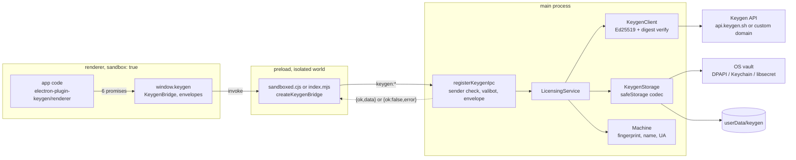
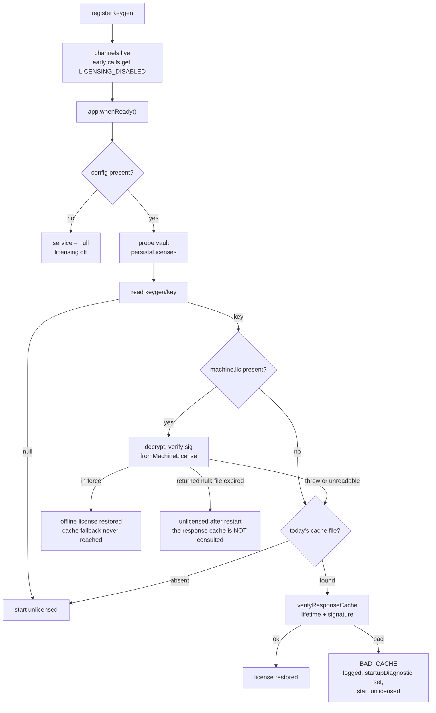
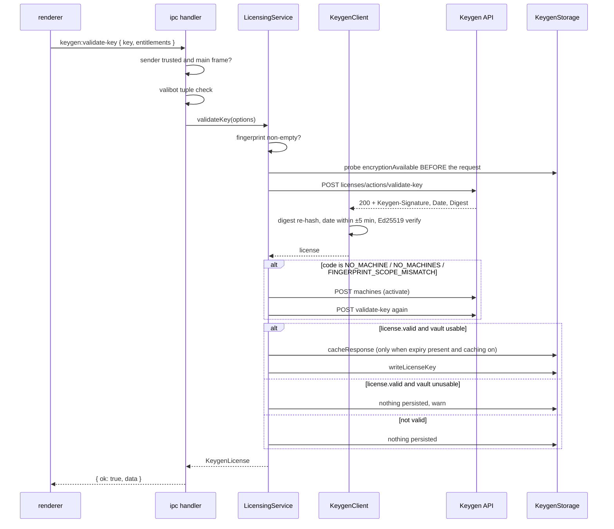
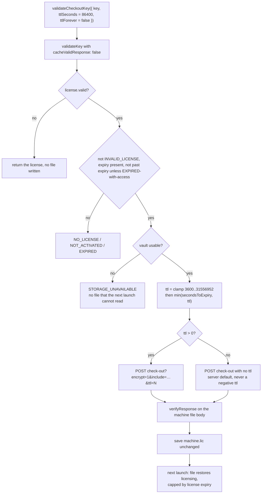
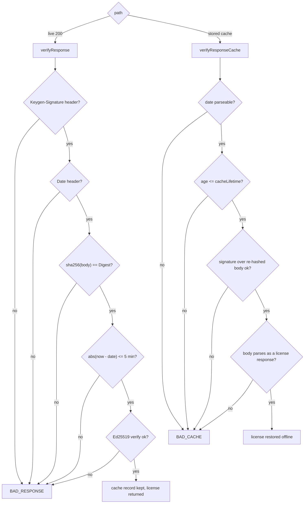
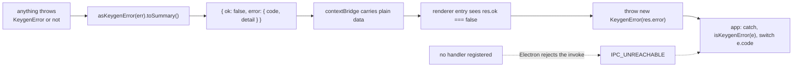

# Features

What `electron-plugin-keygen` does, its exact API shapes, and the flow of a licensing call through the
processes. Setup and rationale live in `README.md`; the limits and inherited behaviours live in `BUGS.md`.

Every claim here is from the source in this package (file and line given) or from a run recorded in
`BUGS.md` — the surface is the Tauri plugin's surface, ported, not redesigned.

---

## 1. Package surface

| Import specifier | Runs in | Ships | Purpose |
| --- | --- | --- | --- |
| `electron-plugin-keygen` | main | `dist/main/index.js` | `registerKeygen`, `KeygenBuilder`, config, IPC registration, preload paths, service |
| `electron-plugin-keygen/renderer` | renderer | `dist/renderer/index.js` | the `keygen` API object, `KeygenError`, `isKeygenError` |
| `electron-plugin-keygen/preload` | preload (`sandbox: false`) | `dist/preload/index.mjs` | installs `window.keygen`; ESM, so a sandbox refuses it |
| `electron-plugin-keygen/preload/sandboxed` | preload (`sandbox: true`) | `dist/preload/sandboxed.cjs` | same bridge, self-contained CommonJS |
| `electron-plugin-keygen/preload/api` | preload / tests | `dist/preload/api.js` | `createKeygenBridge(invoke)` with no `electron` import |

Peer dependency `electron >= 30`. The main and renderer entries are ESM-only (`exports` has no `require`
condition); the sandboxed preload is CommonJS because that is what a sandboxed renderer can load.

---

## 2. Main-process API

### `registerKeygen` — the one call an app needs

```ts
function registerKeygen(options: RegisterKeygenOptions): Promise<LicensingService | null>
```

| Option | Type | Meaning |
| --- | --- | --- |
| `app` | `KeygenAppHost` | structural: `name`, `getPath("userData")`, `getVersion()`, `getLocale()`, `whenReady()` |
| `ipc` | `IpcMainLike` | structural: `handle(channel, listener)` — `ipcMain` satisfies it |
| `getTrustedWebContentsIds` | `() => number[]` | re-read **per request**, so a closed window loses access without unregistering |
| `config` | `KeygenConfigInput \| null` | omitted → read from `KEYGEN_*` env; `null` → licensing disabled |
| `log` | `Logger` | `{ info, warn, error }`; defaults to `console` with a `[keygen]` prefix |
| `createService` | `(args: InitArgs) => Promise<LicensingService \| null>` | injection point for tests |

Behaviour worth knowing (`lib/main/keygen/plugin.ts:36-68`):

- the six channels are registered **before** `whenReady()` resolves, so an early request gets
  `LICENSING_DISABLED` instead of hanging (`plugin.ts:46`)
- the service is built after the app is ready, when `userData` resolves
- a licensing failure never takes the app down: the error is logged and every channel reports it
  (`plugin.ts:60-65`)

### `KeygenBuilder` — fluent config, same semantics as the Rust `Builder`

```ts
KeygenBuilder.new(accountId, verifyKey): KeygenBuilder          // hosted Keygen
KeygenBuilder.withCustomDomain(customDomain, verifyKey): KeygenBuilder  // self-hosted
  .apiUrl(url)          // ignored once a custom domain is set
  .versionHeader(header)// sent as Keygen-Version
  .cacheLifetime(min)   // clamped to [60, 1440] at set time
  .build(): KeygenConfigInput
```

`KeygenConfigInput` / resolved `KeygenConfig` (`lib/main/keygen/config.ts:15-36`):

| Field | Default | Rule |
| --- | --- | --- |
| `verifyKey` | required | must match `/^[0-9a-fA-F]{64}$/` — the account's hex Ed25519 public key, else `CONFIG` |
| `accountId` | — | required unless `customDomain` is set |
| `apiUrl` | `https://api.keygen.sh` | dropped when `customDomain` is set |
| `customDomain` | — | requests go to `{customDomain}/v1/...`, account id ignored |
| `versionHeader` | `null` | visible-ASCII filtered before sending |
| `cacheLifetime` | `240` min | `clampCacheLifetime`: non-finite → default, else truncated into `[60, 1440]` |
| `maxClockDrift` | `5` min | not settable; signed response must be within ±5 minutes |

Nothing licensing-critical is hardcoded: `configFromEnv()` returns `null` when `KEYGEN_VERIFY_KEY` is
unset, and that is what disables licensing (`config.ts:95-106`).

| Env var | Maps to |
| --- | --- |
| `KEYGEN_VERIFY_KEY` | `verifyKey` (gate: unset means off) |
| `KEYGEN_ACCOUNT_ID` | `accountId` |
| `KEYGEN_API_URL` | `apiUrl` |
| `KEYGEN_CUSTOM_DOMAIN` | `customDomain` |
| `KEYGEN_VERSION_HEADER` | `versionHeader` |
| `KEYGEN_CACHE_LIFETIME` | `cacheLifetime` (minutes) |

### Preload path helpers

```ts
keygenPreloadPath(): string        // dist/preload/index.mjs   — unsandboxed only
keygenSandboxedPreloadPath(): string // dist/preload/sandboxed.cjs — the one for sandbox: true
```

Both resolve through the package `exports` map with a relative `dist/` fallback
(`lib/main/preload-path.ts`).

### The service, and the low-level pieces around it

```ts
createLicensingService(args: InitArgs): Promise<LicensingService | null>
buildSafeStorageCodec(): SecretCodec       // real safeStorage, methods bound in vault.ts
registerKeygenIpc(ipc, getService, isTrustedSender): void
makeWindowTrustChecker(ids: () => number[]): (event: unknown) => boolean
resolveConfig(input): KeygenConfig   isHexKey(key): boolean   clampCacheLifetime(min): number
buildDefaultHeaders(config, userAgent): Record<string, string>
KeygenError  asKeygenError(err): KeygenError
```

`LicensingService` is a **main-process** object; the renderer only ever sees the six channels.

| Member | Kind | Note |
| --- | --- | --- |
| `getLicense()` | sync | in-memory license or `null` — no I/O |
| `getLicenseKey()` | async | decrypts `keygen/key` |
| `validateKey(options)` | async | validate, auto-activate on `NO_MACHINE`/`NO_MACHINES`/`FINGERPRINT_SCOPE_MISMATCH`, re-validate (`service.ts:151-168`) |
| `validateCheckoutKey(options)` | async | `validateKey` with caching off, then `checkout` when valid (`service.ts:363`) |
| `activate()` / `checkout(ttl, forever)` | async | public on the service, **not** exposed over IPC |
| `resetLicense()` | sync | machine file + response cache + in-memory state; keeps the cached key |
| `resetLicenseKey()` | sync | cached key only |
| `persistsLicenses` | getter | `false` when the OS vault is unusable — check this in the main process (`service.ts:58`) |
| `startupDiagnostic` | getter | sanitized reason startup left the app unlicensed; deliberately **not** an IPC channel (`service.ts:144`) |
| `init()` | async | probes the vault, restores state, records `startupDiagnostic` |

---

## 3. Renderer API

`window.keygen` — installed by either preload — is the **bridge**: six methods returning the envelope
untouched, because `contextBridge` strips custom fields off thrown objects.

```ts
type IpcResult<T> = { ok: true; data: T } | { ok: false; error: { code: string; detail: string } }
```

`electron-plugin-keygen/renderer` is the layer that unwraps it, so application code deals with values
and thrown `KeygenError`s:

```ts
import { keygen, isKeygenError, KeygenError } from "electron-plugin-keygen/renderer";

const license = await keygen.validateKey({ key });
// or the same six as named exports:
getLicense()  getLicenseKey()  validateKey(o)  validateCheckoutKey(o)  resetLicense()  resetLicenseKey()

createKeygenLicensingApi(bridge: KeygenBridge | null): KeygenLicensingAPI  // tests, custom wiring
isKeygenError(err): err is { code: string; detail: string }                // cross-realm safe
```

| Method | Argument | Resolves to | Rejects with |
| --- | --- | --- | --- |
| `getLicense()` | — | `KeygenLicense \| null` | `LICENSING_DISABLED`, `UNTRUSTED_SENDER` |
| `getLicenseKey()` | — | `string \| null` | as above, `STORAGE_*` |
| `validateKey({ key, entitlements?, cacheValidResponse? })` | defaults `[]`, `true` | `KeygenLicense` | `NO_FINGERPRINT`, `REQUEST_ERROR`, `BAD_RESPONSE`, server codes |
| `validateCheckoutKey({ key, entitlements?, ttlSeconds?, ttlForever? })` | defaults `86400`, `false` | `KeygenLicense` | above plus `INVALID_LICENSE`, `NOT_ACTIVATED`, `EXPIRED`, `STORAGE_UNAVAILABLE` |
| `resetLicense()` | — | `void` | `LICENSING_DISABLED`, `UNTRUSTED_SENDER` |
| `resetLicenseKey()` | — | `void` | as above |

Three renderer-side codes describe the wiring, not the license (`lib/renderer/index.ts:41-61`):
`NO_KEYGEN_BRIDGE` (no preload on this window), `IPC_UNREACHABLE` (no handler registered — the call never
reached a licensing operation), `"unknown"` (malformed envelope).

---

## 4. IPC contract

Six fixed channel names (`lib/shared/keygen-types.ts:62-69`), every handler doing the same three things
(`lib/main/keygen/ipc.ts:61-85`):

1. **sender policy** — the web contents id must be in `getTrustedWebContentsIds()` *and* the frame must
   be that window's main frame, so iframes get no licensing access (`ipc.ts:88-99`)
2. **argument validation** — valibot, tuple-shaped (`ipc.ts:21-38`): `keygen:*` with no arguments
   validate as `v.tuple([])`; `validateKey` requires `{ key: string, entitlements?: string[],
   cacheValidResponse?: boolean }`; `validateCheckoutKey` additionally requires an integer
   `ttlSeconds >= 0` and `ttlForever?: boolean`
3. **envelope** — success `{ ok: true, data }`, any failure `{ ok: false, error: { code, detail } }`;
   nothing throws across the boundary

| Channel | Args | `data` on success |
| --- | --- | --- |
| `keygen:get-license` | none | `KeygenLicense \| null` |
| `keygen:get-license-key` | none | `string \| null` |
| `keygen:validate-key` | `ValidateKeyOptions` | `KeygenLicense` |
| `keygen:validate-checkout-key` | `ValidateCheckoutKeyOptions` | `KeygenLicense` |
| `keygen:reset-license` | none | `null` |
| `keygen:reset-license-key` | none | `null` |

There is no arbitrary-invoke channel, no filesystem channel, and no channel that reaches `activate()` or
`checkout()` directly.

### `KeygenLicense` — what the renderer receives

```ts
type KeygenLicense = {
  key: string; code: string; detail: string;
  expiry: string | null;   // null before activation unless policy expirationBasis is FROM_CREATION
  valid: boolean; policyId: string; entitlements: string[];
  metadata: Record<string, unknown>;
}
```

`code` carries the Keygen status string (`VALID`, `EXPIRED`, `NO_MACHINES`, …). It is a response field,
never a verdict: `valid` is what to check, and the signature is verified before this object exists.

---

## 5. Error codes

`KeygenError` is `{ code, detail }`, message `Keygen Error: {code}: {detail}`.

| Code | Raised by | Meaning |
| --- | --- | --- |
| `CONFIG` | `resolveConfig` | verify key not 64 hex chars, or no account id without a custom domain |
| `LICENSING_DISABLED` | every channel | no config in this build |
| `UNTRUSTED_SENDER` | every channel | frame or window not in the trust list |
| `NO_FINGERPRINT` | `validateKey`, `activate` | the platform identity read returned `""` |
| `REQUEST_ERROR` | `KeygenClient.post` | fetch failed or the 90 s timeout fired |
| `HTTP_ERROR` | `mapStatusError` | non-2xx outside 400-499 |
| `BAD_RESPONSE` | `verifyResponse` | missing header, digest mismatch, date outside ±5 min, signature invalid |
| `BAD_CACHE` | `verifyResponseCache` | stored response past `cacheLifetime`, unverifiable, or unparseable |
| `STORAGE_UNAVAILABLE` | writes, `checkout` | OS vault unusable; `checkout` refuses rather than issue an unreadable machine file |
| `STORAGE_DECRYPT_FAILED` | reads | ciphertext tampered or key rotated |
| `INVALID_LICENSE` / `NOT_ACTIVATED` / `EXPIRED` / `NO_LICENSE` | `checkout` guards | the license state does not permit a machine file |
| `NOT_FOUND` | `rawValidate` | the account-level license object was not found |
| server `code` | `mapStatusError` | first entry of the API `errors[]` array, verbatim |
| `ERR` | parse/IO paths | Rust's `ParseErr`/`Io`/`PathErr` equivalent |
| `NO_KEYGEN_BRIDGE` / `IPC_UNREACHABLE` / `unknown` | renderer entry | wiring problems, see §3 |

---

## 6. Storage

Under `app.getPath("userData")`, layout preserved from the plugin (`lib/main/keygen/storage.ts`):

```
userData/keygen/machine.lic              Keygen machine file, its own format, server-encrypted
userData/keygen/key                      cached license key — safeStorage ciphertext
userData/keygen/validation_cache/<sha256>  one signed response per local day, encrypted
```

| Rule | Where |
| --- | --- |
| cache filename = `sha256("{licenseKey}:{YYYY-MM-DD local}")` | `storage.ts:118-122` |
| cached responses are wrapped in a `KGC1\n` envelope before the base64 ciphertext | `storage.ts:31`, `:128` |
| a cache file **without** that envelope — the pre-encryption format — is deleted on sight and reads as `null` | `storage.ts:139` |
| no plaintext is ever written: every write probes the vault first and fails with `STORAGE_UNAVAILABLE` | `storage.ts` guard |
| entries from other days are removed when today's entry is found | `clearResponseCacheExcept`, `storage.ts:177` |
| `machine.lic` format is untouched: `-----BEGIN MACHINE FILE-----` armor, base64 JSON `{enc,sig,alg}`, AES-256-GCM under `sha256(key ‖ fingerprint)`, `alg` must be `aes-256-gcm+ed25519` | `machine.ts:150-235` |

Windows DPAPI protects against other **users**, not other applications in your session — stated in
`README.md` and `BUGS.md` rather than oversold here.

---

## 7. Feature inventory

### Verification and crypto
- Ed25519 verification of every 200 response, over `(request-target)`, `host`, `date`, `digest` — the
  body digest is re-hashed, so a 200 alone is never treated as a valid license (`client.ts:90-130`)
- ±5-minute freshness on the signed `Date`, using `Math.abs` — a future-dated capture plus a rolled-back
  clock cannot be replayed indefinitely (`client.ts:114-121`; a deliberate divergence from upstream)
- cached responses re-verified against the stored signature with `cacheLifetime` enforced, failing as
  `BAD_CACHE` (`client.ts:136-158`)
- machine file decrypted and its signature verified with the same account key (`service.ts:114-131`)
- Node `crypto` only — no new native dependency

### Storage policy
- availability probed **before** the network call, so a successful validation cannot become a storage
  error afterwards (`service.ts:186`)
- an invalid key is never persisted, and never overwrites a valid cached key (`service.ts:213-223`)
- a valid license with an unusable vault validates, warns, and does not persist — surfaced through
  `persistsLicenses`
- `safeStorage`'s async API used when present, sync API otherwise, and methods always **bound** to the
  object; `basic_text` on Linux counts as unusable (`lib/main/keygen/vault.ts`)
- no license material placed in renderer storage: this package writes nothing from the renderer at all
- log calls interpolate only error messages and `KeygenError` details — every log site in `lib/main` was
  checked; none of them passes a license key, machine file, or response body

### Licensing flow
- `POST v1/accounts/{id}/licenses/actions/validate-key`, fingerprint scope, optional entitlement scope
- auto-activate then re-validate on the three `NO_MACHINE`-family codes (`service.ts:157-165`)
- `POST .../machines` for activation; `POST .../machines/{fp}/actions/check-out?encrypt=1&include=…&ttl=N`
  for the offline file
- ttl clamped to `[3600, 31556952]` seconds and then to `min(secondsToExpiry, clamped)` — the license,
  not the caller, sets the ceiling (`service.ts:317-334`)
- `ttlForever` only honoured when the license `valid && code === "EXPIRED"` (`shouldMaintainAccess`)
- an already-past-expiry license sends **no** `ttl` rather than a negative one
- `Keygen-Version` header, `User-Agent` in the plugin's `{app}/{ver} {os}/{osver} {engine}/{enginever} {locale}` form with `Electron/<version>` as the engine (`machine.ts:47-56`)
- 90-second timeout on every request (`client.ts:32`)

### Offline
- startup restore order: machine file first, then today's encrypted response cache (`service.ts:81-112`)
- a present-but-expired machine file does **not** fall through to the cache — upstream behaviour, kept
- the cache lives only for the remainder of the local calendar day; `validateCheckoutKey()` is the call
  that survives a restart (see the day-boundary note in `BUGS.md`)

### Platform identity
- fingerprint from `MachineGuid` (win32, `reg query`), `IOPlatformUUID` (darwin, `ioreg`),
  `/etc/machine-id` or `/var/lib/dbus/machine-id` (linux) — injectable, and `""` fails loudly as
  `NO_FINGERPRINT` (`machine.ts:62-92`)
- device name `os.hostname()`, platform string `{os} - {distro} - {arch}` with `whoami`-style tokens

### Hardening and diagnostics
- sandbox-first: a CommonJS preload that works under `sandbox: true`, verified in a live renderer
- sender trust re-evaluated per request; main frame only
- `startupDiagnostic` for main-process diagnostics without adding an IPC channel
- `log` injection point; sanitized messages, no key material
- verification scripts: `npm run verify:electron` (real vault + real renderers) and `npm run verify:live`
  (real account, results recorded in `BUGS.md`)

---

## 8. Flowcharts

### 8.1 Process topology



Nothing sensitive crosses into the renderer world as state: the only channel is the six methods, and the
renderer's own storage is never touched by this package.

### 8.2 Startup — how a license is restored without the network



The expired-machine-file branch is upstream behaviour kept deliberately (`service.ts:85-96`): a file that
exists but has run out returns `null` from the first branch, so the same-day response cache is never
consulted. Restart after a checked-out license expires and the app is unlicensed until it revalidates
online.

### 8.3 `validateKey()`



### 8.4 `validateCheckoutKey()` and the offline window



### 8.5 Where a response gets rejected



The cache path re-hashes `Digest` from the stored body, which is why the body is stored whole —
redacting any byte invalidates the signature, and one extra byte in a cached file was confirmed to fail
`BAD_CACHE` against a real signed response (`BUGS.md`).

### 8.6 Failure across the boundary



---

## 9. Deliberately absent

- no payment or billing surface, no Cashfree, no separate licensing backend, no database
- no machine deletion — the package only POSTs, so a seat taken here cannot be released from it
  (`BUGS.md`, "Seats are never released")
- no `activate()` / `checkout()` channel for the renderer, and no raw-request or filesystem channel
- no plaintext fallback when OS encryption is missing, and no machine file that the next launch could
  not decrypt
- no weakening of signature verification, no clock-tamper tolerance beyond the ±5-minute window, no
  bypass of the offline TTL
- not verified on this machine: macOS Keychain, Linux libsecret and the `basic_text` branch, packaged
  asar layouts
